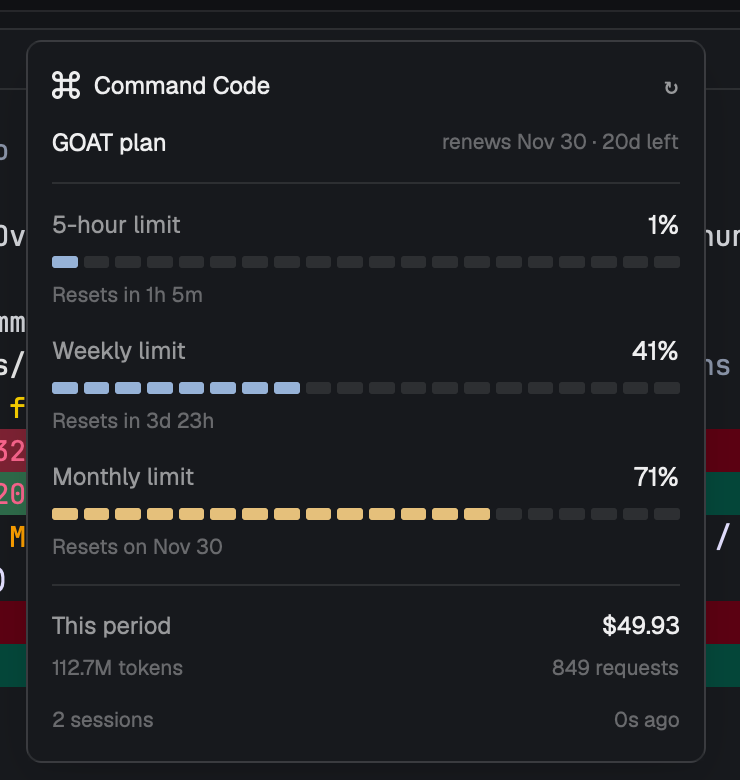

# herdr-commandcode-usage

Your Command Code plan usage inside [Herdr](https://herdr.dev) desktop — the same numbers as
commandcode.ai's Overview, one keystroke away.



## What it shows

- Plan and renewal (`GOAT`, `renews Nov 30 · 20d left`)
- **5-hour limit**, **weekly limit**, **monthly limit** as percentages, with segmented bars
- Reset times (`Resets in 47m`, `Resets in 3d 23h`, `Resets on Nov 30`)
- This period's spend, tokens, and request count
- Live Command Code session count in Herdr

## Requirements

- Command Code CLI, signed in (`commandcode status`) — the mod reads `~/.commandcode/auth.json`
- Herdr desktop 0.1.14+
- `curl`; on macOS the helper reads the key with `plutil`, falling back to `sed`

## Install

```sh
cp -R mods/commandcode-usage ~/.config/herdr-app/mods/
```

Merge `keys.json` into `~/.config/herdr-app/keys.json` — it adds `⌘⇧U` → `mod.open:commandcode-usage`.

Herdr hot-reloads mods. Validate the copy:

```sh
herdr-app check ~/.config/herdr-app/mods/commandcode-usage
```

Press **⌘⇧U** to toggle the popup. To keep it docked beside a terminal instead:

```sh
herdr-app do pane.split --direction right --mod commandcode-usage
```

## How it gets the data

`mods/commandcode-usage/fetch-usage.sh` reads `apiKey` from `~/.commandcode/auth.json` and calls
`https://api.commandcode.ai` with `Authorization: Bearer`:

| Endpoint | Used for |
| --- | --- |
| `/alpha/whoami?limits=1` | org id (null for personal accounts) |
| `/alpha/billing/credits` | 5-hour and weekly windows, remaining credits |
| `/alpha/billing/subscriptions` | plan id, status, period end |
| `/alpha/usage/summary` | period spend, tokens, request count |

`main.js` runs that script every 60 seconds, caches the last snapshot in the mod's `localStorage`
for an instant first paint, and shows `stale · <error>` when a refresh fails.

The token is read inside the shell script, only ever sent to `api.commandcode.ai`, and never
written anywhere by this mod.

## Notes

- These are Command Code's alpha endpoints, not a published API contract; they may change.
- Monthly percentage is `(plan allowance − remaining credits) / plan allowance`; plan allowances
  are mapped in `main.js` (`Go 10`, `GOAT 70`, `Pro 30/80`, `Provider 15`, `Max 150`, `Ultra 300`,
  `Teams Pro 40`).

## Uninstall

Remove `~/.config/herdr-app/mods/commandcode-usage/` and the `cmd-shift-u` entry in `keys.json`.

## License

MIT
