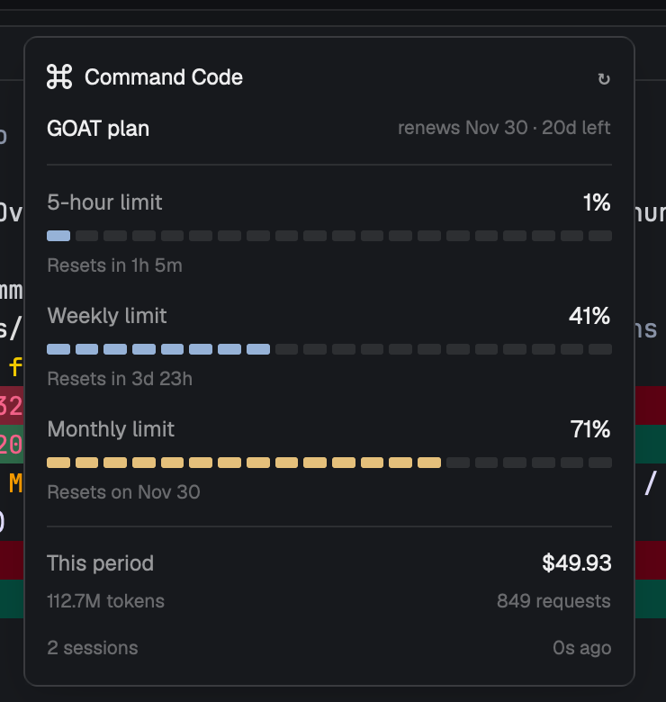

# Command Code usage

A Herdr popup that shows your Command Code plan usage — the same three limits as commandcode.ai's
Overview page — plus this period's spend, tokens, and request count. Press ⌘⇧U to toggle it.

## What you see

Top to bottom, in a 340×400 popup at the top of the window (offset 56):

1. **Header**: the shipped `icons/command-code.svg` at 14 px, "Command Code" in semibold, and a
   dim `↻` at the right that refreshes on click.
2. **Plan row**: `<plan> plan` on the left (`GOAT plan`), `renews Nov 30 · 20d left` in 10.5 px dim
   on the right. A non-active subscription status appears in the blocked color instead.
3. A 1 px divider.
4. **Three limit rows**, each: label in the muted color, the percentage right-aligned at 13 px
   semibold, a segmented bar, and a 10.5 px dim reset line.
   - `5-hour limit` — percent of `windowLimits.fiveHour.used / cap`; `Resets in 47m`.
   - `Weekly limit` — same for `weekly`; `Resets in 3d 23h`.
   - `Monthly limit` — percent of `(plan allowance − monthlyCredits) / plan allowance`;
     `Resets on <period end>`.
   The bar is 20 blocks, each 12×6 px, radius 1.5, laid out with `justify_between` across the full
   width. Filled blocks use the accent color below 70%, the working color from 70% to 90%, and the
   blocked color at 90% or when the window reports `exceeded`. A nonzero percentage always fills at
   least one block. An exceeded window shows `Limit reached` instead of the reset line.
5. A 1 px divider.
6. **This period**: total cost on the right (`$49.93`), then tokens (`112.7M tokens`) and
   `849 requests` in 10.5 px dim.
7. **Footer**: live Command Code session count (`2 sessions`, plus `· 1 needs you` when any is
   blocked) and `Ns ago` for the last successful fetch.

The whole panel is `theme().surface` with 12 px padding, 9 px gap, 12 px text, and follows the
user's theme.

## How it behaves

- `init` loads the last snapshot from `localStorage` (`commandcode-usage:v1`) so the popup paints
  instantly, then refreshes; afterwards `cx.timer.every(60_000)` refreshes again.
- A refresh runs `exec(${appHome()}/mods/commandcode-usage/fetch-usage.sh)` with a 45 s timeout and
  parses one JSON object. Failures never clear the panel: they add `stale · <error>` above the
  footer, and a first-run failure shows the error alone.
- While loading with no snapshot, the header shows `…` and the refresh glyph is not clickable.
- `2 sessions` comes from `agents().filter(a => a.app === "command-code")`, so it is live without
  polling.
- The reset countdowns are recomputed on every render, which the 60 s refresh drives; there is no
  extra timer.
- The mod ships `place: "none"` and an overlay spec, so `mod.open commandcode-usage` toggles the
  popup. `keys.json` binds it to ⌘⇧U. Esc closes it. It can also be used as a pane
  (`pane.split {direction: "right", mod: "commandcode-usage"}`).

## Built from

Files:

- `mods/commandcode-usage/main.js` — the View.
- `mods/commandcode-usage/fetch-usage.sh` — reads the key, curls the endpoints, prints one JSON
  snapshot. Executable (mode 755).
- `mods/commandcode-usage/mod.json` — `{"place":"none","title":"Command Code","overlay":{"kind":"popup","at":"top","offset":56,"width":340,"height":400}}`
- `keys.json` — `{"global":{"cmd-shift-u":"mod.open:commandcode-usage"}}` (merge, don't replace).

Imports: `View`, `div`, `svg` from `gpui-kit`; `v_flex`, `h_flex` from `gpui-base`; `agents`,
`appHome`, `exec`, `theme` from `herdr`.

Data path: `fetch-usage.sh` reads `apiKey` from `~/.commandcode/auth.json` (via `plutil -extract`,
falling back to `sed`), then GETs against `https://api.commandcode.ai` with
`Authorization: Bearer`:

- `/alpha/whoami?limits=1` — org id; when present, `?orgId=` is added to the rest.
- `/alpha/billing/credits` — `credits.monthlyCredits`, `windowLimits.fiveHour|weekly`.
- `/alpha/billing/subscriptions` — `data.planId`, `status`, `currentPeriodEnd`.
- `/alpha/usage/summary` — `totalCost`, `totalTokens`, `totalCount`.

Plan maps in `main.js`: names `individual-go→Go`, `individual-goat→GOAT`, `individual-pro→Pro`,
`individual-provider→Provider`, `individual-max→Max`, `individual-ultra→Ultra`, `teams-pro→Teams Pro`;
allowances `10, 70, 30, 15, 150, 300, 40` (and `individual-pro-v1→80`).

Helpers: `money`, `tokens` (K/M/B), `wait` (d/h/m countdown), `ago`, `renewal` (manual month names).

## Watch out

- **No `Intl` options.** `toLocaleDateString(undefined, {month:"short"})` is ignored in the Herdr
  mod runtime and returns `11/30/2026`; format months from a literal array instead.
- **`plutil` prints its own errors on stdout**, so a missing auth file yields an error string as the
  "key". Validate the token shape (`[A-Za-z0-9_-]`, length ≥ 10) before using it, or every request
  goes out unauthenticated.
- **Flex-sized segments are uneven.** `flex_1()` on 20 empty divs rounds to visibly different widths.
  Fix the width (12 px) and distribute with `justify_between`.
- **No `setTimeout`/`setInterval`** in Herdr mods — use `cx.timer.every` and `cx.spawn`, and never
  keep a `cx` for later.
- **`localStorage` is per mod copy**, so a popup and a pane copy do not share their cache; each
  fetches once on start.
- The endpoints are Command Code's **alpha** routes, not a public contract. The plan-allowance table
  must be updated if plans change, or the monthly percentage falls back to `totalCost / allowance`.
- Monthly percentage needs either `monthlyCredits` from the credits endpoint or `totalCost` from the
  summary; with neither, the row is omitted rather than shown wrong.
- The token is read inside the shell script so it never appears in the mod's JS, argv, or shared
  state; keep it that way. The script only sends it to `api.commandcode.ai`.
- Requires `curl`, and a signed-in Command Code CLI on the same machine; it does not work for BYOK
  local-only setups with no account.

## Done when

- `herdr-app check mods/commandcode-usage` passes.
- Pressing ⌘⇧U toggles a popup showing plan, three percentages, three reset lines, period totals,
  and the session count; Esc closes it.
- The three percentages match commandcode.ai's Overview for the same account.
- The numbers change after the 60 s refresh, and `herdr-app status` reports no errors.
- Signed out (or with the auth file renamed), the panel shows `not signed in to Command Code`
  instead of zeroed bars.
